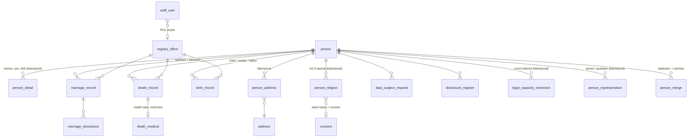

# Civil Registry — Database Design

Schema-only design for a state civil registry: persons, births, marriages, deaths,
with role-based access, tamper-evident auditing, GDPR and NIS2 support.

Target: **PostgreSQL 14+** (pgcrypto, btree_gist). Files:

| File | Purpose |
|------|---------|
| [`schema.sql`](schema.sql) | Runnable DDL: schemas, tables, roles, RLS, triggers, grants |
| [`test_schema.sql`](test_schema.sql) | 11 smoke tests (T1–T11), all verified against PostgreSQL 14.19 |
| [`import_codelists.py`](import_codelists.py) | One-time import of official MetaIS codelists → `seed_codelists.sql` |
| [`seed_codelists.sql`](seed_codelists.sql) | Generated seed with 6 187 official codelist items (idempotent) |
| [`openapi.yaml`](openapi.yaml) | Application-layer API contract (OpenAPI 3.0.3, validated) |

## 1. Scope and key decisions

| Decision | Choice | Rationale |
|----------|--------|-----------|
| Person ID | Opaque random ID with check digit (`P-XXXXX-XXXXX-C`) | Carries no birth date/sex (GDPR data minimisation); survives sex/date corrections without re-keying. National ID (rodne cislo equivalent) is a separate **encrypted attribute**, never a key. |
| History | Bitemporal rows (valid time + transaction time) | A registry must answer both "where did X live in 2020" and "what did we *believe* in 2020" — retroactive corrections stay fully traceable. |
| Vital records | Append-only, transaction-time versioned | Records describe an event (the event date is the fact); corrections insert a new version, originals are never updated or deleted. |
| Audit | Trigger-based row-change log with SHA-256 hash chain | Tamper-evident (NIS2 integrity); application adds a read-access log for GDPR Art. 15. |

## 2. Entity overview



Schemas: `codelist` (reference data), `registry` (personal data), `gdpr`
(data-protection operations), `audit` (append-only logs).

### 2.1 Official codelists (MetaIS)

Reference data comes from the official [MetaIS codelist repository](https://metais.slovensko.sk/data-objects/codelists)
via its public API (`/api/codelist-repo`, no auth). One-time import:
`./import_codelists.py` generates an idempotent `seed_codelists.sql`
(INSERT … ON CONFLICT DO UPDATE).

| MetaIS | Codelist | Target table | Items |
|--------|----------|--------------|------:|
| CL000086 | Krajina OSN | `codelist.country` | 252 |
| CL000023 | Kraj | `codelist.region` | 9 |
| CL000024 | Okres | `codelist.district` | 80 |
| CL000025 | Obec | `codelist.municipality` | 2 930 |
| CL010141 | Časť obce | `codelist.municipality_part` | 1 777 |
| CL000015 | Pracovisko matričného úradu | `codelist.registry_office` | 977 |
| CL004002 | Rodinný stav | `codelist.marital_status` | 7 |
| CL004003 | Existenčný stav | `codelist.existence_status` | 3 |
| CL000062/63 | Titul pred/za menom | `codelist.academic_title` | 51 + 14 |
| CL000014 | Súd | `codelist.court` | 79 |
| CL000010 | Typ rodinného vzťahu | `codelist.family_relation_type` | 2 |
| CL003003 | Pohlavie | `codelist.sex` (mapping only) | 3 |
| CL010139 | Druh adresy | `codelist.address_type` (mapping only) | 11 |

Design decisions (complexity kept low deliberately):

- **Typed tables, not a generic item model.** Each codelist keeps its own table
  so FKs from `registry.*` stay typed and readable. Uniform provenance columns
  on every codelist table: `source_codelist`, `metais_code`, `item_valid_from`,
  `item_valid_to`.
- **Two classes of codelists.** *Identity* tables use the official MetaIS item
  code as PK (country, municipality, registry office, …). *Semantic* tables
  (`sex`, `address_type`) keep internal stable keys baked into app logic
  (`'permanent'`, `'M'`…, seeded by `schema.sql`); the import only fills their
  `metais_code` mapping (sex M/F/X ↔ 1/2/0 per ISO 5218; address types
  permanent/temporary/foreign ↔ 100001/100002/100003 — `'official'` has no
  MetaIS counterpart).
- **No hierarchy in MetaIS items.** Obec→okres→kraj parent links are NOT part
  of the API payload; `district_code`/`region_code` FKs are nullable — an
  accepted limitation (confirmed by the owner). If ever needed, LAU code
  prefixes allow derivation for municipalities.
- **Not imported:** religion (no MetaIS codelist exists — own table based on
  the ŠÚ SR statistical codelist), streets/address points (that is the Register
  adries reference register, ~1M records, out of scope for a one-time import).
- **Source-data quirks observed:** a few duplicate `itemCode`s exist among
  effective items (e.g. marital status 7→6 unique, municipality parts
  1 777→1 764); DO UPDATE keeps the last occurrence. Title codes overlap
  between CL000062 and CL000063, hence the composite PK
  `(title_code, title_position)`.

`person` is an immutable identity anchor — only the UID, the encrypted national
ID, and an anonymization tombstone flag. Everything that can change lives in
bitemporal satellite tables. A person exists independently of a birth record,
so foreign-born spouses/parents can be registered.

## 3. Person UID

Format `P-XXXXX-XXXXX-C`: 10 crypto-random Crockford base32 characters
(no I/L/O/U — transcription-safe) + position-weighted mod-32 check character.
Space ≈ 1.1 × 10¹⁵; collisions handled by a retry loop in
`registry.generate_person_uid()`; `registry.person_uid_is_valid()` validates
format + check digit and backs a CHECK constraint on the PK.

The legacy national identifier is stored as `national_id_enc` (ciphertext;
key in external KMS/HSM, never in the DB) plus `national_id_hmac` (keyed HMAC,
unique) so clerks can do exact-match lookups without decryption.

## 4. Bitemporal model

Every mutable satellite row (`person_detail`, `person_address`, `person_religion`)
carries two time axes:

| Axis | Columns | Meaning |
|------|---------|---------|
| Valid time | `valid_from` / `valid_to` | When the fact was true in the real world |
| Transaction time | `recorded_at` / `superseded_at` (+ `superseded_by`, `change_reason`) | When the registry believed it |

Rows are never rewritten; a correction sets `superseded_at` on the old row and
inserts replacements. GiST **exclusion constraints** guarantee at most one
current-belief row per person (and per address type) at any point in valid time.

```sql
-- Where did X live on 2020-01-01 (current belief)?
SELECT * FROM registry.person_address
WHERE person_uid = $1 AND superseded_at IS NULL
  AND daterange(valid_from, valid_to) @> DATE '2020-01-01';

-- What did the registry believe on 2021-03-01 (as-of audit)?
SELECT * FROM registry.person_address
WHERE person_uid = $1
  AND recorded_at <= '2021-03-01'
  AND (superseded_at IS NULL OR superseded_at > '2021-03-01');
```

Address change = supersede the open row, re-insert it with `valid_to` closed,
insert the new address row (exercised in test T4).

Vital records are uni-temporal (versioned only): `recorded_at`, `superseded_at`,
`supersedes_id`, `amendment_reason`, `approved_by` (supervisor sign-off, enforced
by CHECK: an amendment must state a reason). The registry number
`(office_code, book_year, entry_no)` is unique among current versions
(partial unique index).

**Partially known dates.** Foreign and historic records often know only the
year (or month) of birth. `person_detail.date_of_birth` therefore carries a
`date_of_birth_precision` (`day` | `month` | `year`); the date column stores
the earliest day of the known period. Age-dependent rules (portal adulthood,
parent access to a minor) compute against the stored date — for `year`
precision this treats the person as born on Jan 1, a conservative-enough
approximation documented here deliberately.

## 5. Roles and access matrix

DB group roles; login users get membership. The application sets per transaction:
`app.user_id`, `app.request_id`, `app.legal_basis` (GUCs read by RLS and audit);
for the citizen portal additionally `app.person_uid` (the eID-resolved identity
that all "own data only" RLS policies compare against).

| Object | clerk | supervisor | agency_reader | dpo_officer | security_auditor | citizen (portal) | registry_app |
|---|---|---|---|---|---|---|---|
| Vital records | R/W **own office only** (RLS) | R/W nationwide | — | R | — | R **own/participant** (RLS) | — |
| person, detail, address | R/W | R/W | — | R | — | R **own** (RLS) | — |
| `person_religion` (Art. 9) | R/W | R/W | **—** | R | — | R **own** (RLS) | — |
| `death_medical` (health) | R/W | R/W | **—** | R | — | — | — |
| `v_person_current` (minimal view) | — | — | R | R | — | — | — |
| `gdpr.consent` | R/W | R/W | — | R/W | — | R **own** (RLS) | — |
| `gdpr.data_subject_request` | — | — | — | R/W | — | R + file **own** (RLS) | — |
| `gdpr.disclosure_register` | — | — | — | R/W | — | R **own** (RLS) | — |
| `audit.audit_log` | — | — | — | R | R | — | — |
| `audit.access_log` | — | — | — | R | R | R **own** (RLS) | INSERT |
| `audit.security_event` | — | — | — | — | R | — | INSERT |
| `staff_user` admin | R | R/W | — | — | — | — | — |

The citizen role (`registry_citizen`) is strictly read-only on registry data
(no UPDATE/INSERT grants at all); its single write capability is filing a data
subject request for itself or a represented person — the RLS `WITH CHECK`
policy rejects anything else. Vital-record visibility follows participation:
birth records where the citizen is the child or a parent, marriages where they
are a spouse (incl. dissolutions), death records where they are the subject.

### 5.1 Portal eligibility and representation

Self-service access follows the statutory conditions common to public-registry
portals, enforced **in the database** by `registry.citizen_is_eligible()`
(SECURITY DEFINER, evaluated inside every citizen RLS policy):

1. the user is registered as a **living person** (no current death record —
   this also cuts off a stolen identity the moment a death is registered);
2. the user is an **adult** (18+ per current identity detail);
3. the user has **no current court-ordered restriction of legal capacity**
   (`legal_capacity_restriction`, bitemporal, with court reference).

Access to another person's data goes through `person_representation`
(bitemporal): a **parent** reaches their child's data only while the child is
a minor (checked dynamically against the child's current birth date); a
court-appointed **guardian** reaches the represented person's data regardless
of age. `registry.citizen_portal_uid_accessible(target)` combines both rules
and is the single predicate used by all citizen policies — including filing
a DSR on behalf of the represented person (Art. 12 exercise via
representative).

Edge case (intentional): a person with an erroneous death record cannot use
the portal until the record is corrected — matching how such situations are
resolved in practice (in person at the registry office).

### 5.2 Person identity merge

Two records discovered to describe the same physical person are linked via
`person_merge` (duplicate → primary): the duplicate record is preserved
untouched (append-only), consumers resolve the canonical identity with
`registry.resolve_person_uid()`, and `v_person_current` hides active
duplicates. Merges are a supervisor-level operation, carry a mandatory reason
and approval, and are reversible (supersede with `reversal_reason`). Chains
are forbidden by trigger — a primary must not itself be merged, so resolution
is always a single hop.

Enforcement layers: schema `USAGE` grants → table/column grants → RLS policies
(clerk scoped to own office via `registry.current_staff_office()`) → the
`v_person_current` view (no religion, no health, no ciphertext, no history,
excludes anonymized persons) as the only surface for other agencies.
`UPDATE` for clerks exists only to close bitemporal rows; hard `DELETE` is
blocked by trigger on all personal-data tables.

## 6. Auditing (NIS2)

- **`audit.audit_log`** — trigger-captured INSERT/UPDATE/DELETE on every table
  in `registry`, `gdpr`, `codelist`: actor (app user + DB role), client address,
  request correlation id, legal basis, old/new row as JSONB. Partitioned by
  month (ops job creates partitions; default partition catches gaps).
- **Hash chain** — each entry stores `prev_hash` and
  `row_hash = SHA-256(prev_hash ‖ payload)`; the chain head is serialized via a
  row lock (accepted write-throughput trade-off). Any retroactive edit breaks
  the chain (verified in test T7). Periodically anchor the head hash outside
  the DB (WORM storage / log service) so a superuser rebuild is also detectable.
- **`audit.access_log`** — read access to personal data, written by the
  application with purpose + legal basis; feeds GDPR Art. 15 answers.
- **`audit.security_event`** — login failures, privilege/config changes,
  backups, incidents; `incident_ref` groups events, `reported_to_csirt_at`
  tracks NIS2 Art. 23 notification steps (24 h early warning / 72 h notification
  / final report as event types).
- Audit tables are append-only (`REVOKE UPDATE/DELETE/TRUNCATE`).

NIS2 items that are **not** schema concerns (deliberately out of scope here):
network segmentation, backup/DR testing, MFA, supply-chain policy, encrypted
connections — they belong to the operations layer.

## 7. GDPR mapping

| GDPR requirement | Mechanism in schema |
|---|---|
| Lawfulness / accountability (Art. 5, 6, 30) | `legal_basis` captured on writes (audit) and disclosures; `gdpr.disclosure_register` = per-person hand-over log |
| Special categories (Art. 9) — religion, health | Isolated tables `person_religion`, `death_medical` with separate grants; religion rows must carry an Art. 9(2) basis; consent-based rows require FK to `gdpr.consent` (enforced by CHECK, test T5) |
| Consent + withdrawal (Art. 7) | `gdpr.consent` with `withdrawn_at`; withdrawal ⇒ supersede the religion row |
| Data minimisation (Art. 5(1)(c)) | Opaque UID; agency access only via minimal current-state view |
| Right of access (Art. 15) | Bitemporal tables reconstruct full data; `audit.access_log` + `disclosure_register` answer "who saw it" |
| Rectification (Art. 16) | Supersede-and-insert keeps both the error and the correction traceable |
| Erasure (Art. 17) | Usually refused for registry books under Art. 17(3)(b)/(d) — record the refusal in `data_subject_request.resolution`; retention expiry uses `person.anonymized` tombstone (UPDATE, never DELETE) |
| DSR workflow (Art. 12) | `gdpr.data_subject_request` with generated statutory `due_at` (received + 1 month) and status flow |
| Storage limitation (Art. 5(1)(e)) | `gdpr.retention_policy` seeded with statutory values (zákon 154/1994 Z.z.: births 100 y, marriages/deaths 75 y, action `review` — records go to the state archive); enforcement is a scheduled job |
| Pseudonymisation / security (Art. 32) | National ID ciphertext + HMAC lookup, key outside DB; role separation; append-only audit |

## 8. Assumptions and open items

- **Encryption at the application layer.** The DB never sees the national-ID
  key; app encrypts/HMACs before insert. Decide KMS product at implementation.
- **`registry_app` connection model.** Recommended: pool connects as
  `registry_app`, then `SET ROLE` to the end user's group role per transaction
  so RLS + grants apply to the human, not the service account.
- **View ownership.** `v_person_current` runs with owner rights (bypasses RLS
  by design — it is the sanctioned minimal surface). Keep its owner a dedicated
  definer role, not superuser.
- **Chain-head serialization** bottlenecks bulk writes (~single-writer). If
  migration/bulk load is needed, disable triggers under a documented, logged
  procedure and re-anchor the chain afterwards.
- **Not modeled (YAGNI for schema stage):** document/certificate issuance,
  adoption & paternity acknowledgment workflows, name-change administrative
  proceedings, inter-registry sync. All fit the same versioned-record pattern.

## 8.1 Possible future extensions

Concepts common in mature population-registry designs, noted here as general
candidates for later phases (none blocks the current schema):

- **Record-level confidentiality (disclosure level).** A per-person or
  per-record protection level (e.g. protected witnesses, officers in covert
  roles) that RLS can enforce on top of role scoping. A related official
  codelist for publication levels already exists in the national codelist
  repository.
- **Death date as an interval.** When remains are found, the death is known
  only as a range ("died between X and Y"); a `daterange` column models this
  more faithfully than the current `date_of_death` + `date_found` pair.
- **Names in context.** Distinguishing the legal name, the name as printed on
  an identity document, and the name at birth (relevant for transliteration of
  foreign names); fits the existing bitemporal detail pattern as additional
  name contexts.
- **Sectoral pseudonymous identifiers.** Deriving a different opaque
  identifier per receiving agency so recipients cannot cross-link persons
  across sectors — a strong Art. 25 (data protection by design) upgrade for
  the disclosure register.
- **Row-level integrity checksums.** A keyed checksum/signature on current
  person rows (not just the audit hash chain) to detect direct data
  manipulation in the live tables.
- **Change events as first-class entities.** Promoting `change_reason` to a
  structured change-event record (type, source, triggering document) that all
  versions created by one business event reference.
- **Register membership lifecycle.** Explicit enrollment/removal state with
  dated reasons (loss of citizenship, erroneous entry, emigration) — distinct
  from death and from anonymization.
- **Erroneous-record state.** Marking a whole record as registered-in-error
  (never deleted), complementing per-version supersede.
- **Multi-source provenance.** When the register aggregates from several
  source systems (citizens, foreigners), per-record provenance flags and
  source identifiers.

## 9. Test data

`test_schema.sql` seeds 10 staff users across all five roles: 4 clerks
(2× Bratislava, Košice, Žilina — exercises RLS office scoping), 2 supervisors
(one office-bound, one central), 2 agency read-only accounts (Sociálna
poisťovňa, ÚPSVaR), 1 DPO, 1 security auditor.

## 10. API layer (contract)

[`openapi.yaml`](openapi.yaml) specifies the application layer over the schema
(OpenAPI 3.0.3, passes `openapi-spec-validator`). Design rules carried over
from the DB design:

- **Roles as OAuth2 scopes** (`registry.clerk` … `registry.security_auditor`,
  `registry.citizen`); per-operation requirements are annotated with
  `x-required-roles`. The gateway maps the token identity to `app.user_id`
  (staff) or `app.person_uid` (citizen, resolved from eID) for the DB session,
  so RLS applies to the human, not the service account.
- **Citizen self-service**: `GET /me` (own composite data) and
  `GET /me/access-log` (who accessed my data, Art. 15); citizen may also call
  the person/record GET endpoints and `POST /gdpr/requests` — always narrowed
  to own data by the DB RLS policies, never by application logic alone.
- **Purpose-bound reads**: every personal-data read requires `X-Access-Purpose`
  (logged to `audit.access_log`) and `X-Request-Id` correlation.
- **Bitemporality in the API**: history endpoints accept `asOfValid` (real-world
  date) and `asOfRecorded` (what the registry believed); writes create new
  versions (`POST …/details`, `POST …/addresses`), never in-place updates.
- **Append-only records**: corrections go through `POST …/amendments`
  (supervisor role; reason mandatory), dissolutions are sub-resources of the
  marriage record.
- **Art. 9 isolation**: religion (`/persons/{uid}/religion`) and death medical
  data (`/deaths/{id}/medical`) are separate endpoints with stricter scopes —
  the agency role cannot reach them at all.
- **GDPR operations**: DSR workflow (`/gdpr/requests`), Art. 15 export
  (`/gdpr/persons/{uid}/export`, itself recorded as a disclosure), consents
  with withdrawal, disclosure register; audit endpoints include hash-chain
  verification for NIS2 (`/audit/chain/verification`).
- Errors are RFC 7807 `application/problem+json`; national ID is accepted for
  exact-match search only and never returned in plaintext.

## 11. Verification

Full pipeline executed against PostgreSQL 14.19: `schema.sql` →
`test_schema.sql` (T1–T14 all pass) → `import_codelists.py` →
`seed_codelists.sql` (6 201 statements, applies cleanly; 65 titles,
2 930+ municipalities, 977 registry offices verified). Tests cover: UID check
digit, person graph insert, bitemporal overlap rejection, address change +
point-in-time query, religion consent constraint, hard-delete block, audit
hash-chain integrity, RLS office scoping, minimal agency view, codelist FK
enforcement + MetaIS mappings, staff-user seed, statutory retention seed, and
citizen own-data-only RLS (sees only own person/records, cannot write person
data, may file a DSR for self but not for others, unmatched identity sees
zero rows), portal eligibility rules (parent sees minor child; identities with
restricted capacity or a death record see nothing), person identity merge
(resolve, view exclusion, chain/duplicate guards), and partial birth-date
precision. `openapi.yaml` passes `openapi-spec-validator`.
